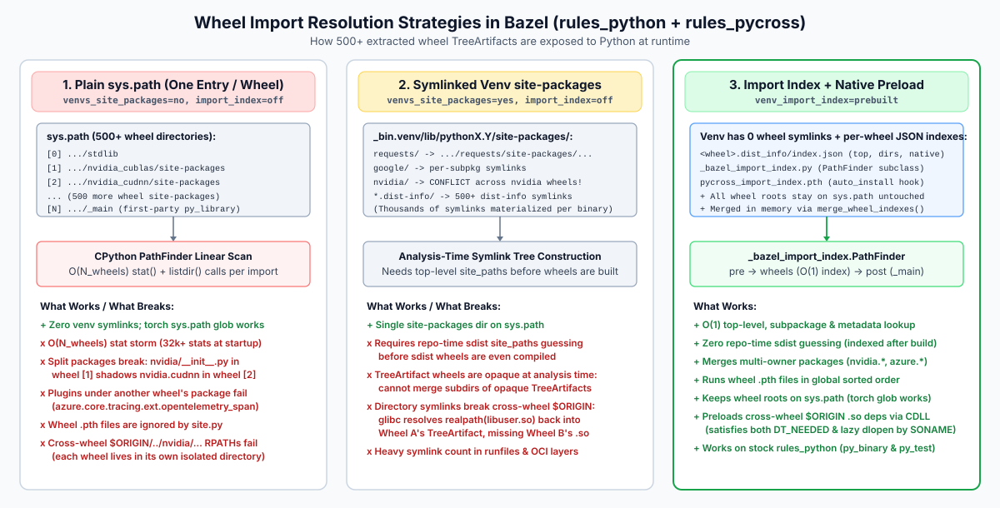
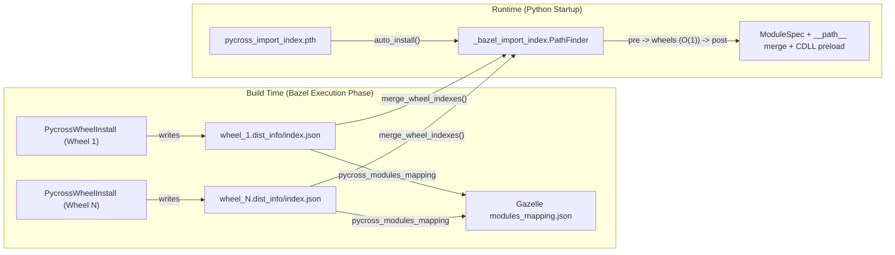
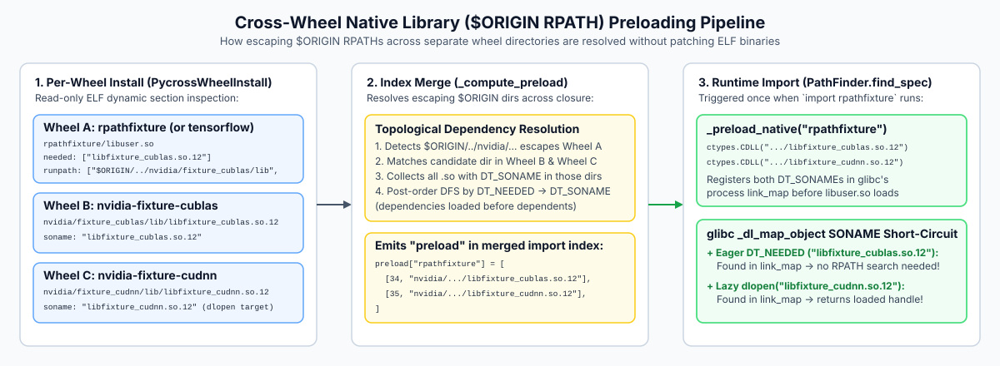
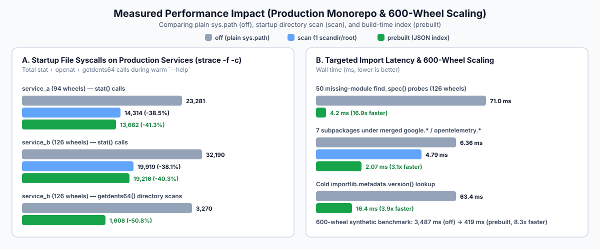

# Venv Import Index & Cross-Wheel Native Preloading

This document explains the **Import Index** (`--@rules_pycross//pycross/settings:venv_import_index`) architecture in `rules_pycross`, why it exists, how it resolves Python imports and cross-wheel `$ORIGIN` shared libraries (`DT_NEEDED` and `dlopen`) without symlinking wheel contents into `site-packages`, and how to try it out.

---

## 1. The Problem: Exposing 500+ Wheel `TreeArtifact`s to Python

In `rules_pycross`, each `pycross_wheel_library` target extracts a wheel (or builds an sdist into a wheel and extracts it) as a Bazel directory output (`TreeArtifact`) at `<wheel_target>/site-packages`.

Historically, there were two ways to expose those wheels to a `py_binary` or `py_test` at runtime, and each had fundamental drawbacks at scale:



### Why Plain `sys.path` (`venvs_site_packages=no`) Breaks or Slows Down
1. **$O(N_{\text{wheels}})$ `stat` storm on every import:** With 500 wheels on `sys.path`, importing a first-party module from `<runfiles>/<workspace>` (which sits *after* wheel imports on `sys.path`) or probing a missing module forces CPython's `PathFinder` to `stat()` all 500 wheel directories.
2. **Split regular packages fail (`nvidia.*`):** Wheels like `nvidia-cublas-cu12`, `nvidia-cudnn-cu12`, and `nvidia-nccl-cu12` each ship an empty `nvidia/__init__.py`. With separate `sys.path` entries, `import nvidia` binds to the first wheel on `sys.path` and makes `nvidia.cudnn` / `nvidia.nccl` unimportable (`ModuleNotFoundError`).
3. **Plugin subpackages under another wheel's regular package fail (`azure.*`):** `azure-core` ships `azure/core/tracing/ext/__init__.py` (a regular package), and `azure-core-tracing-opentelemetry` installs `azure/core/tracing/ext/opentelemetry_span` into that directory. Without merging `azure.core.tracing.ext.__path__` across both wheels, the plugin cannot be imported.
4. **Root `.pth` files in wheels are ignored:** Python's `site` module only processes `.pth` files in the venv's own `site-packages` directory, not in extra `sys.path` entries added later by `_bazel_site_init.py` (breaking packages like `rerun-sdk` that rely on `rerun_sdk.pth`).
5. **Cross-wheel `$ORIGIN` RPATHs fail:** An extension or shared library in Wheel A with `DT_RUNPATH: $ORIGIN/../nvidia/cudnn/lib` looks inside `wheel_A/site-packages/nvidia/cudnn/lib`, which does not exist because `libcudnn.so` is in `wheel_B/site-packages/nvidia/cudnn/lib`.

### Why Symlinked Venvs (`venvs_site_packages=yes`) Hit Analysis-Time Limits
1. **Requires repo-time `site_paths` guessing for sdists:** Because Bazel must declare venv symlinks during the **analysis phase** (before any build action runs), `rules_pycross` had to guess what top-level directories an sdist *will* produce before building it. Compiled CFFI/Cython modules generated at build time (e.g., `_nvx_utf8validator.abi3.so` in `autobahn`) or dynamically generated layouts cannot be known statically at repo time.
2. **Opaque `TreeArtifact`s cannot be merged at subpackage granularity during analysis:** When two `TreeArtifact` wheels both provide `nvidia/__init__.py` or `google/cloud/functions/__init__.py`, Bazel analysis cannot inspect the files inside the `TreeArtifact` directories to synthesize a merged directory tree of file symlinks.
3. **Directory symlinks break cross-wheel `$ORIGIN` RPATHs in `glibc`:** When `site-packages/pkg_a` is a directory symlink to `.../wheel_A/site-packages/pkg_a`, `glibc`'s dynamic linker (`ld.so`) resolves `realpath()` on `pkg_a/libuser.so` before expanding `$ORIGIN`, landing back inside `wheel_A`'s isolated `TreeArtifact` instead of the shared venv `site-packages`.

---

## 2. How the Import Index Works

The Import Index gives binaries the exact semantics of `pip` installing all wheels into a single merged `site-packages` directory **while keeping every wheel in its own isolated `TreeArtifact` on `sys.path` and creating zero wheel symlinks in `.venv`**:



### Build-Time Pipeline
1. **Per-Wheel Index (`<name>.dist_info/index.json`):**
   At the end of every `PycrossWheelInstall` action (after `install_exclude_globs`, `post_install_patches`, and `.pyc` precompilation), [`wheel_index.py`](../pycross/private/tools/wheel_index.py) scans the installed `site-packages` directory and writes a deterministic `<name>.dist_info/index.json` recording:
   - `distribution`: `{"name", "version"}` from `METADATA`
   - `dist_info`: the `.dist-info` directory name
   - `top`: top-level importable module/package names $\rightarrow$ directory entry names
   - `dirs`: all package/subpackage relative directory paths
   - `modules`: leaf modules inside regular packages (for Gazelle)
   - `namespaces`: PEP 420 and `pkgutil`/`pkg_resources` namespace directories
   - `pth` / `pth_paths`: root `.pth` files and relative path entries they add
   - `native`: ELF metadata (`soname`, `needed`, `rpath`, `runpath`) for every `.so` file in the wheel (parsed via pure-Python [`elf_tools.py`](../pycross/private/tools/elf_tools.py))
2. **Exact Gazelle `modules_mapping.json`:**
   [`pycross_modules_mapping`](../pycross/private/modules_mapping.bzl) builds `modules_mapping.json` from the post-install per-wheel `index.json` files instead of repo-time `site_paths` heuristics.
3. **Venv Runtime Injection via `PyInfo.venv_symlinks`:**
   When `--@rules_pycross//pycross/settings:venv_import_index` is enabled (`prebuilt` or `scan`), `pycross_wheel_library` includes `pycross_import_index.pth` and `_bazel_import_index.py` in `PyInfo.venv_symlinks` (and adds `<name>.dist_info/index.json` to runfiles in `prebuilt` mode), propagating automatically through arbitrary chains of stock `py_library` targets into any stock `py_binary` or `py_test`.

### Runtime Finder (`_bazel_import_index.PathFinder`)
At Python startup, `bazel.pth` runs `_bazel_site_init.py` (which populates `sys.path`), and immediately afterward `pycross_import_index.pth` runs `_bazel_import_index.auto_install()`, replacing `importlib.machinery.PathFinder` in `sys.meta_path` with [`_bazel_import_index.PathFinder`](../pycross/private/tools/import_index.py):

- **`pre` $\rightarrow$ `wheels` ($O(1)$) $\rightarrow$ `post` ordering:**
  `sys.path` is partitioned into `pre` (the Python stdlib and any earlier non-wheel paths), `wheels` (all wheel `site-packages` roots collapsed into one virtual merged directory), and `post` (`<runfiles>/<workspace_name>`, where first-party `py_library` sources live).
  - Because `pre` runs first, an `enum34`-style backport wheel can never shadow the stdlib.
  - Because `wheels` resolves in $O(1)$ from the index dict, importing any **first-party `py_library` module** from `post` skips $O(N_{\text{wheels}})$ `stat` calls and jumps straight to `<runfiles>/<workspace_name>`.
- **Multi-owner package & subpackage merging (`merged` & `sub`):**
  When multiple wheels own the same package directory (`nvidia`, `google.cloud`, `azure.core.tracing.ext`), the finder populates `__path__` with all owner directories in `sys.path` order and resolves single-owner subpackages (`sub`) in $O(1)$ without scanning parent directories.
- **First-party + wheel shared namespaces:**
  PEP 420 namespaces shared between first-party `py_library` targets and wheels accumulate portions across `pre`, `wheels`, and `post` (even if Bazel's `legacy_create_init` synthesizes an empty `__init__.py` in `<runfiles>/_main`).
- **$O(1)$ `importlib.metadata` with memoized `read_text()`:**
  Distribution lookups by name (`importlib.metadata.version("...")`) resolve in $O(1)$ from the index, and `PathDistribution.read_text()` is cached in memory for `METADATA`, `PKG-INFO`, and `entry_points.txt`.

---

## 3. Cross-Wheel Native Library Preloading & Dynamic Loader Hooks

Many native Python wheels (such as `tensorflow` + `nvidia-*-cu12`, `onnxruntime-gpu`, or split C++/CUDA wheel families) rely on shared libraries distributed across separate wheels. When each wheel lives in its own Bazel `TreeArtifact`, three cross-wheel native loading patterns break without assistance:

1. **Escaping `$ORIGIN` RPATHs:** An extension or library in Wheel A has `DT_RPATH` / `DT_RUNPATH` set to `$ORIGIN/../nvidia/cudnn/lib`, which resolves inside Wheel A's `TreeArtifact` instead of Wheel B's.
2. **Unsatisfied cross-wheel `DT_NEEDED` by bare SONAME:** A plugin `.so` in Wheel A (such as `libonnxruntime_providers_cuda.so`) has `DT_NEEDED: ["libcublas.so.12", "libcudnn.so.9"]` with no escaping `$ORIGIN` RPATH, expecting its dependencies to be preloaded or on `LD_LIBRARY_PATH`.
3. **Python-level `ctypes` / `cffi` path computation and bare-SONAME `dlopen`:** Python initialization code constructs `os.path.join(os.path.dirname(__file__), "..", "nvidia", ...)` or calls `ctypes.CDLL("libcudnn.so.9")` / `ctypes.util.find_library("cublas")` / `ffi.dlopen("cublas")`.

Instead of patching ELF binaries on disk (which would couple wheel install actions across dependencies) or setting `LD_LIBRARY_PATH` (which leaks into subprocesses), the Import Index handles these via **index-driven preloading and lazy loader hooks**:



### 3.1 Build-Time / Startup Dependency Graph (`_compute_native`)
1. During per-wheel indexing, [`elf_tools.py`](../pycross/private/tools/elf_tools.py) records `{soname, needed, rpath, runpath}` for every ELF `.so` file and SONAME symlink in the wheel.
2. During index merging ([`merge_wheel_indexes()`](../pycross/private/tools/import_index.py)), `_compute_native()` builds a cross-wheel SONAME table (`"sonames"`) and dependency closure (`"preload"` and `"native_deps"`):
   - **System/toolchain/driver SONAME denylist (`_is_system_soname`):** Standard libc, C++/Fortran runtime, compression/crypto/system libraries, and host GPU driver stubs (`libc`, `libm`, `libdl`, `libpthread`, `librt`, `libgcc_s`, `libstdc++`, `libgomp`, `libatomic`, `libgfortran`, `libz`, `libbz2`, `liblzma`, `libffi`, `libexpat`, `libssl`, `libcrypto`, `libsqlite3`, `libuuid`, `libcuda.so.*`, `libnvidia-*`, `ld-linux*`) are excluded from `"sonames"` and cross-wheel preloading so bundled copies in one wheel never hijack system/driver libraries across the process.
   - **Escaping `$ORIGIN` RPATHs:** Any `$ORIGIN/...` `rpath` or `runpath` entry that escapes the owning wheel and matches a directory in another wheel pulls in the target directory's shared libraries.
   - **Unsatisfied cross-wheel `DT_NEEDED`:** Any non-denylisted `DT_NEEDED` entry not satisfied within the same wheel that matches a `soname` (or non-extension library filename) in another wheel is added as a dependency seed (enabled by default; disable with `RULES_PYTHON_IMPORT_INDEX_SONAME_PRELOAD=0`).
   - **Trigger keys:** Preload lists are keyed by the owning top-level package, by every importable top-level name when libraries live in `<pkg>.libs/` (`auditwheel` layout), or by the single-owner subpackage in `"sub"` (such as `"nvidia.cudnn"`) when the top-level namespace is shared across wheels.
   - **Topological sort:** A post-order DFS orders transitive `DT_NEEDED` and escaping RPATH dependencies before dependents.

### 3.2 `glibc` vs `musl` Preload Backends
- **`glibc`:** In `glibc` (`elf/dl-load.c`, `_dl_map_object`), whenever the dynamic linker resolves a library by bare SONAME—whether via `DT_NEEDED` or `dlopen("libcudnn.so.9", RTLD_NOW)`—it checks the `DT_SONAME` of every library already in the process's `link_map` *before* searching `DT_RPATH`, `LD_LIBRARY_PATH`, or `DT_RUNPATH`. Calling `ctypes.CDLL(abs_path)` in topological order registers each library's `DT_SONAME` in `link_map`.
- **`musl` (Alpine Linux):** In `musl` (`ldso/dynlink.c`), `dlopen("/abs/path/to/libfoo.so.1")` leaves `p->shortname` unset (`NULL`) because the argument contains `'/'`, so a subsequent `DT_NEEDED` or bare-name `dlopen("libfoo.so.1")` will not match the already-loaded library unless `p->shortname` is populated via a `DT_RPATH` + bare-name load. On `musl`, `_load_native_path()` synthesizes a tiny (~360-byte) in-memory ELF64 `ET_DYN` stub (`PT_LOAD` `PF_R` only, `DT_RPATH = dirname(abs_path)`, `DT_NEEDED = soname or basename(abs_path)`) via `os.memfd_create("pycross_stub", MFD_CLOEXEC | MFD_NOEXEC_SEAL)` (falling back to `NamedTemporaryFile` if `memfd_create` or `/proc/self/fd` is unavailable, or directly to `_raw_dlopen(abs_path)` on 32-bit ELF or if `filename != DT_SONAME` and no matching `DT_SONAME` symlink exists in the directory) and loads it via `/proc/self/fd/<fd>`, which causes `musl` to resolve the library by shortname through `DT_RPATH` and populate `p->shortname`.

### 3.3 Zero-Startup-Cost `ctypes` / `cffi` Hooks & First-Party Extensions
When `_ctypes`, `ctypes`, `ctypes.util`, or `_cffi_backend` is imported, `PathFinder.find_spec` wraps the module loader to install lightweight resolvers (costing `0 ms` when those modules are not imported):
- **`_ctypes.dlopen` & `_cffi_backend` (`load_library`, `FFI.dlopen`):**
  - If a path containing `'/'` does not exist on disk and escaped a wheel root in `_INDEX.roots` via `..` (e.g., `<torch_wheel>/site-packages/torch/../nvidia/cudnn/lib/libcudnn.so.9`), rewrites it to the owning wheel root's path and preloads its `"native_deps"` closure before calling `dlopen`.
  - For bare library names (no `'/'`), calls the original `dlopen` / `load_library` **first** (preserving `LD_LIBRARY_PATH`, `/etc/ld.so.cache`, and system library directories) and only falls back to `"sonames"` if the original call raises `OSError`.
- **`ctypes.util.find_library`:** Calls the original `find_library(name)` first and only falls back to non-denylisted wheel `"sonames"` (`<name>`, `lib<name>.so`, or `lib<name>.so.*`) when the system lookup returns `None`.
- **First-party `ExtensionFileLoader` `DT_NEEDED` inspection:** When `PathFinder` resolves a first-party `ExtensionFileLoader` `.so` (under `runfiles_root` or `post` `sys.path`, excluding stdlib `lib-dynload` / `sys.base_prefix` and wheel roots), `_maybe_preload_extension_needed()` reads its ELF `DT_NEEDED` entries and preloads any matching wheel libraries and their transitive dependencies before returning the module spec.

### 3.4 Remaining Scope & Known Limitations
- **C/C++ `dlopen("/abs/escaped/path.so")` constructed in native code (e.g., via `dladdr` + `../nvidia/...`):** C-level `dlopen` bypasses Python's `_ctypes.dlopen`. If the library was already preloaded by SONAME and the native caller falls back to bare-SONAME `dlopen`, it succeeds; if the native caller only tries the broken relative path without fallback, it requires either preloading before the native check or filesystem/linker-level path mapping.
- **Subprocess binaries (`bin/ptxas`, `nvcc`) & data files (`libdevice.10.bc`):** Subprocesses do not inherit in-process `ctypes.CDLL` state or Python `PathFinder` hooks. Setting `RULES_PYTHON_IMPORT_INDEX_SET_CUDA_ENV=1` (opt-in, default off) configures `CUDA_HOME` and prepends `<wheel_root>/nvidia/<cuda_nvcc|cu13>/bin` to `PATH` when `nvidia.cuda_nvcc` or `nvidia.cu13` is present in the index.
- **`bootstrap_impl=system_python` on Bazel 7:** On Bazel 8+, `rules_python` creates the full venv (`pycross_import_index.pth`) under both `bootstrap_impl=script` and `bootstrap_impl=system_python`. On Bazel 7 with `bootstrap_impl=system_python`, `.pth` files in the venv are not processed unless `bootstrap_impl=script` is enabled.
- **macOS (`dyld`) and Windows (`LoadLibraryExW`):** Currently `auto_install()` is a no-op on Windows, and the ELF metadata parser targets Linux ELF binaries (`@loader_path` Mach-O and Windows `.dll` directories are not yet indexed).

---

## 4. Understanding the Merged Import Index Schema

When `merge_wheel_indexes()` merges the per-wheel `<wheel>.dist_info/index.json` files at startup, wheel root paths are listed once in the `"roots"` array, and all other sections reference wheels by their **0-based integer index into `"roots"`**:

```json
{
  "version": 1,
  "roots": [
    "rules_pycross++uv+uv__pkgs/_lock/backports-entry-points-selectable@1.3.0/site-packages",
    "rules_pycross++uv+uv__pkgs/_lock/backports-tarfile@1.2.0/site-packages",
    "...",
    "_main/fixtures/nvidia_fixture_cublas/site-packages",
    "_main/fixtures/nvidia_fixture_cudnn/site-packages",
    "_main/fixtures/nvidia_fixture_nccl/site-packages",
    "_main/fixtures/pthfixture/site-packages",
    "_main/fixtures/rpathfixture/site-packages"
  ],
  "top": {
    "nvidia": [[34, ["nvidia"]], [35, ["nvidia"]], [36, ["nvidia"]]],
    "typing_extensions": [[17, ["typing_extensions.py"]]]
  },
  "merged": {
    "nvidia": [34, 35, 36],
    "google.cloud": [9, 24, 25, 28]
  },
  "sub": {
    "nvidia.fixture_cublas": 34,
    "nvidia.fixture_cudnn": 35,
    "google.cloud.storage": 28
  },
  "preload": {
    "rpathfixture": [
      [34, "nvidia/fixture_cublas/lib/libfixture_cublas.so.12"],
      [35, "nvidia/fixture_cudnn/lib/libfixture_cudnn.so.12"]
    ]
  },
  "pth": [
    ["pthfixture.pth", 37]
  ]
}
```

| Field | Meaning |
|---|---|
| `"roots"` | Ordered list of runfiles-relative wheel `site-packages` paths. Every integer `i` elsewhere in the file refers to `roots[i]`. |
| `"top"` | Maps top-level import name $\rightarrow$ `[[root_idx, [filenames]], ...]` in `sys.path` order. |
| `"merged"` | Maps dotted package directory $\rightarrow$ `[root_idx, ...]` for directories present in $\ge 2$ wheels. |
| `"sub"` | Maps dotted subpackage directory $\rightarrow$ `root_idx` for single-owner subdirectories whose parent is in `"merged"`, enabling $O(1)$ subpackage resolution without `stat`ting parent directories. |
| `"preload"` | Maps package/subpackage trigger key $\rightarrow$ `[[root_idx, rel_so_path], ...]` in topological load order for cross-wheel `$ORIGIN` and `DT_NEEDED` native libraries. |
| `"sonames"` | Maps library SONAME (or filename for libraries without `DT_SONAME`) $\rightarrow$ `[root_idx, rel_so_path]` for runtime `dlopen` / `find_library` / first-party extension resolution. |
| `"native_deps"` | Maps `"<root_idx>:<rel_so_path>"` $\rightarrow$ `[[dep_root_idx, dep_rel_so_path], ...]` in topological order for on-demand preloading when a library is loaded directly via `dlopen` or a first-party extension. |
| `"pth"` | Sorted `[[pth_filename, root_idx], ...]` executed via `site.addpackage` at startup. |
| `"dists"` | Maps normalized distribution name $\rightarrow$ `[[root_idx, dist_info_dirname], ...]` for $O(1)$ `importlib.metadata` lookups. |

---

## 5. Benchmarks (Production Monorepo & 600-Wheel Scaling)



| Metric | `off` (Plain `sys.path`) | `scan` (Startup `scandir`) | `prebuilt` (JSON Index) | Improvement (`prebuilt` vs `off`) |
|---|---:|---:|---:|---:|
| **`service_a` (94 wheels) `stat` syscalls** | 23,281 | 14,314 | **13,662** | **$-41.3\%$** |
| **`service_a` (94 wheels) `getdents64` syscalls** | 1,414 | 1,226 | **984** | **$-30.4\%$** |
| **`service_b` (126 wheels) `stat` syscalls** | 32,190 | 19,919 | **19,216** | **$-40.3\%$** |
| **`service_b` (126 wheels) `getdents64` syscalls** | 3,270 | 1,940 | **1,608** | **$-50.8\%$** |
| **50 missing-module `find_spec` probes (126 wheels)** | 71.0 ms | 4.2 ms | **4.2 ms** | **$16.9\times$ faster** |
| **7 subpackages under merged `google.*`/`opentelemetry.*`** | 6.36 ms | 4.79 ms | **2.07 ms** | **$3.1\times$ faster** |
| **Cold `importlib.metadata.version()` lookup** | 63.4 ms | 18.1 ms | **16.4 ms** | **$3.9\times$ faster** |
| **Index initialization time (100 pure-Python wheels)** | — | 4.1 ms | **5.8 ms** | **Zero `getdents64` on wheel roots** |
| **Index initialization time (100 wheels, 15 native / 750 `.so`)** | — | — | **14.8 ms** (`_compute_native`: 6.7 ms) | **Includes full cross-wheel ELF graph** |
| **600-wheel synthetic total import benchmark** | 3,487.3 ms | 420.3 ms | **418.6 ms** | **$8.3\times$ faster** |

---

## 6. Usage & Interactive Demo

The Import Index works with **unmodified stock `@rules_python//python:defs.bzl` `py_binary` and `py_test` targets** on released `rules_python` with zero `BUILD` file changes and no `rules_python` fork required.

### Flags

Enable the index via `--@rules_pycross//pycross/settings:venv_import_index`:
```bash
# Build-time per-wheel indexes + cross-wheel native preloading (recommended):
build --@rules_python//python/config_settings:bootstrap_impl=script
build --@rules_pycross//pycross/settings:venv_import_index=prebuilt

# Or startup directory scan (for pure-Python wheels without native preloading):
build --@rules_pycross//pycross/settings:venv_import_index=scan
```

How it works on stock `py_binary` / `py_test`:
- `pycross_wheel_library` automatically injects `pycross_import_index.pth` and `_bazel_import_index.py` into the venv via `PyInfo.venv_symlinks` (even through arbitrary chains of stock first-party `py_library` targets).
- At startup, `_load_per_wheel_prebuilt()` reads the per-wheel `<wheel>.dist_info/index.json` files from runfiles and computes the merged index + `"preload"` / `"sonames"` / `"native_deps"` tables in memory via `merge_wheel_indexes()`.

### Runtime Environment Variables
- `RULES_PYTHON_IMPORT_INDEX=off|scan|prebuilt|verify`: Override the index mode at runtime. `verify` cross-checks the prebuilt index against a live `os.scandir` walk of all wheel roots and exits non-zero on any discrepancy.
- `RULES_PYTHON_IMPORT_INDEX_DEBUG=1`: Log index load timing, merged packages, `find_spec` resolutions, `ctypes.CDLL` preloads, and `dlopen` rewrites to `stderr`.
- `RULES_PYTHON_IMPORT_INDEX_SONAME_PRELOAD=0|1` (default `1`): Enable or disable cross-wheel `DT_NEEDED` preloading by SONAME when no escaping `$ORIGIN` RPATH is present.
- `RULES_PYTHON_IMPORT_INDEX_SET_CUDA_ENV=0|1` (default `0`): Opt in to setting `CUDA_HOME` and prepending `<wheel_root>/nvidia/<cuda_nvcc|cu13>/bin` to `PATH` when `nvidia.cuda_nvcc` or `nvidia.cu13` is present in the wheel index and `CUDA_HOME` / `CUDA_PATH` are unset.
- `RULES_PYTHON_IMPORT_INDEX_LIBC=glibc|musl`: Override automatic libc detection (`os.confstr("CS_GNU_LIBC_VERSION")`) for testing the `glibc` direct `CDLL` vs `musl` `memfd` stub ELF loader backend.

### Running the Interactive Demo (`tests/e2e/namespace_pkgs`)

```bash
cd tests/e2e/namespace_pkgs

# 1. Prebuilt index with stock py_binary (all 5 checks pass):
bazel run --config=index //:demo

# 2. Debug trace showing startup timing and ctypes.CDLL preloads:
RULES_PYTHON_IMPORT_INDEX_DEBUG=1 bazel run --config=index //:demo

# 3. Verify mode (asserts prebuilt index matches disk 100%):
RULES_PYTHON_IMPORT_INDEX=verify bazel run --config=index //:demo

# 4. Compare with scan mode (Python imports pass, cross-wheel $ORIGIN RPATH fails):
bazel run --config=scan //:demo

# 5. Compare with plain sys.path (4 of 5 checks fail):
bazel run //:demo --@rules_python//python/config_settings:venvs_site_packages=no
```
